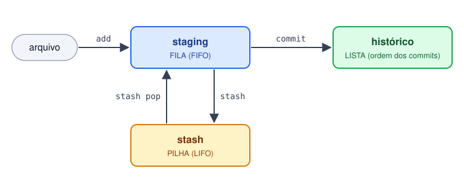
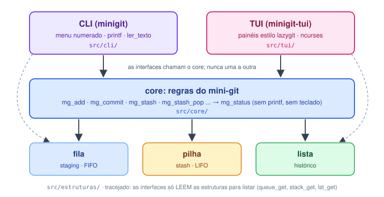

# Mini-Git – Lista, Pilha e Fila integradas

**Grupo:** MINI GIT – Projeto de Algoritmos, Universidade Católica de Santos

Este repositório junta as três entregas anteriores num único programa:

| Entrega | Estrutura | Parte do mini-git | Repositório de origem |
|---|---|---|---|
| 2 | Lista sequencial | Histórico de commits (`log`) | `MiniGitEntrega2` |
| 3 | Pilha | Stash (`stash`, `stash pop`) | `MiniGitPilha` |
| 4 | Fila circular | Staging (`add`) | `MiniGitFila` |

Juntas, elas formam o fluxo de um Git de verdade: o arquivo entra no **staging** (fila), o
**commit** esvazia o staging e grava no **histórico** (lista), e o **stash** guarda o
staging pela metade numa **pilha** para recuperar depois.



O mesmo mini-git tem **duas interfaces**, que usam exatamente as mesmas regras:

| Executável | Interface | Precisa de |
|---|---|---|
| `minigit` | Menu numerado no terminal (CLI) | só o compilador C |
| `minigit-tui` | Painéis no estilo do [lazygit](https://github.com/jesseduffield/lazygit) (TUI) | ncurses (Linux/macOS) ou PDCurses (Windows) |

## Como compilar e rodar

```
make            # compila as duas interfaces
./minigit       # menu numerado
./minigit-tui   # interface de painéis
```

Também existem `make cli`, `make tui`, `make run`, `make run-tui` e `make clean`.

Se a TUI não compilar, instale o ncurses: `sudo pacman -S ncurses` (Arch),
`sudo apt install libncurses-dev` (Debian/Ubuntu). No Windows com MinGW + PDCurses:
`mingw32-make tui CURSES_LIBS=-lpdcurses`.

Sem o `make`:

```
gcc -std=c99 -Iinclude/estruturas -Iinclude/core -Iinclude/cli \
    src/estruturas/*.c src/core/*.c src/cli/*.c -o minigit
gcc -std=c99 -Iinclude/estruturas -Iinclude/core -Iinclude/tui \
    src/estruturas/*.c src/core/*.c src/tui/*.c -lncursesw -o minigit-tui
```

Os dois compilam sem avisos com `-Wall -Wextra -Wpedantic` e rodam sem erros com
`-fsanitize=address,undefined`.

## Arquitetura: interface separada das funcionalidades



```
include/ e src/
  estruturas/   fila, pilha, lista, tipos       ← não sabem o que é git, não imprimem
  core/         minigit, repositorio            ← regras do mini-git, sem printf e sem teclado
  cli/          menu, comandos, entrada, main   ← interface de menu numerado
  tui/          tui, estado, paineis, teclas,   ← interface de painéis (ncurses)
                acoes, popup, main
```

| Camada | Pode usar | Não pode usar |
|---|---|---|
| `estruturas` | só ela mesma | I/O, core, interfaces |
| `core` | `estruturas` | `printf`, teclado, curses, CLI, TUI |
| `cli` | `core`, `estruturas` (só leitura) | TUI |
| `tui` | `core`, `estruturas` (só leitura), ncurses | CLI |

O `Makefile` faz a ferramenta conferir essas regras:

- cada camada compila só com os `-I` permitidos. Se o core tentar
  `#include "paineis.h"`, a compilação falha;
- só a TUI liga com ncurses. Se o core chamar uma função do curses, o link do
  `minigit` falha.

### O core: dados prontos e resultado em código

Toda operação que altera o repositório está em `include/core/minigit.h`. Ela recebe os dados
já lidos e devolve um `mg_status`:

```c
mg_status mg_add(Repositorio *r, const char *nome);
mg_status mg_commit(Repositorio *r, const char *mensagem, const char *autor, Commit *criado);
mg_status mg_stash(Repositorio *r, const char *descricao, Stash *criado);
mg_status mg_stash_pop(Repositorio *r, Stash *recuperado, int *devolvidos);
...
const char *mg_mensagem(mg_status s);     /* "staging cheio (maximo de 5 arquivos)" */
```

Cada interface decide **como pedir** os dados (CLI: `ler_texto`; TUI: popup) e **como
mostrar** o resultado (CLI: `printf`; TUI: linha de aviso colorida). As funções
`mg_pode_add`, `mg_pode_commit` e `mg_pode_stash` permitem perguntar antes de pedir dados
(não faz sentido pedir a mensagem do commit com o staging vazio).

Para **listar**, as interfaces leem as estruturas por funções que não alteram nada:
`queue_get(f, i)`, `stack_get(p, i)` e `lst_get(l, k)`. Nenhuma interface acessa `dados[]`,
`itens[]`, `comeco` ou `topo` diretamente.

Mais detalhes, incluindo como criar um comando novo nas duas interfaces, em
[`docs/arquitetura.md`](docs/arquitetura.md).

## Interface de painéis (TUI)

```
┌[1] Status──────────────────┐┌Detalhes──────────────────────────────────────────────────┐
│mini-git  commits 1/10      ││commit 1                                                  │
│staging 0/5  stash 1/5      ││Autor:     Nicolas                                        │
└────────────────────────────┘│Mensagem:  tela de login                                  │
┌[2] Staging (fila)──────────┐│                                                          │
│(vazio)                     ││Arquivos (na ordem em que sairam do staging):             │
│                            ││  1. diff.c (add 3)                                       │
└────────────────────────────┘│  2. main.c (add 4)                                       │
┌[3] Commits (lista)─────────┐│                                                          │
│  1 tela de login           ││Lista: 'd' remove o commit selecionado, de qualquer       │
│                            ││posicao.                                                  │
└────────────────────────────┘│                                                          │
┌[4] Stash (pilha)───────────┐│                                                          │
│stash@{0} login pela metade ││                                                          │
│                            ││                                                          │
└────────────────────────────┘└──────────────────────────────────────────────────────────┘
 Commit 1 criado com 2 arquivo(s). Staging vazio.
 d: remover commit   c: commit   Tab: proximo painel   j/k: mover   ?: ajuda   q: sair
```

À esquerda ficam as três estruturas, uma em cada painel. À direita aparece o detalhe do
item selecionado. Embaixo ficam o resultado da última ação e as teclas do painel ativo.

| Tecla | Painel | O que faz | Core |
|---|---|---|---|
| `1`–`4`, `Tab`, `h`/`l` | qualquer | troca de painel | — |
| `j`/`k`, setas | qualquer | move o cursor | — |
| `a` | qualquer | add (popup com o nome) | `mg_add` |
| `c` | qualquer | commit (popups de mensagem e autor) | `mg_commit` |
| `u` | Staging | tira o arquivo da frente | `mg_unstage_primeiro` |
| `s` | Staging | guarda o staging no stash | `mg_stash` |
| `d` | Commits | remove o commit selecionado (pede confirmação) | `mg_remover_commit` |
| `g` | Stash | stash pop: devolve o topo ao staging | `mg_stash_pop` |
| `d` | Stash | stash drop: descarta o topo (pede confirmação) | `mg_stash_drop` |
| `?` | qualquer | ajuda com as teclas do painel | — |
| `q` | qualquer | sair | — |

A TUI mostra as regras de cada estrutura:

- No **Stash**, o cursor pode ir até `stash@{2}`, mas `g` e `d` sempre agem em
  `stash@{0}`, porque numa pilha só o topo sai.
- No **Staging**, `u` tira sempre o arquivo da frente, porque numa fila só a frente sai.
- Nos **Commits**, `d` remove o commit selecionado em qualquer posição, porque uma lista
  remove de qualquer lugar.

Esc cancela qualquer popup. O terminal precisa ter pelo menos 72×18.

## Interface de menu (CLI)

```
=== MINI-GIT ===

-- Staging (fila) --
 1 - Adicionar arquivo (add / enqueue)
 2 - Ver o proximo arquivo (front)
 3 - Status do staging
 4 - Tirar o primeiro arquivo do staging (dequeue)

-- Historico (lista) --
 5 - Fazer commit (staging -> historico)
 6 - Ver historico (log)
 7 - Buscar commit pelo id
 8 - Remover commit pelo id

-- Stash (pilha) --
 9 - Guardar staging no stash (push)
10 - Recuperar o ultimo stash (pop -> staging)
11 - Ver o stash do topo (top)
12 - Listar stashes
13 - Descartar o ultimo stash (drop)

 0 - Sair
```

| Opção | Core | Funções das estruturas |
|---|---|---|
| 1 | `mg_pode_add`, `mg_add` | `queue_isfull`, `queue_get` (nome repetido), `enqueue` |
| 2 | — | `front` |
| 3 | — | `queue_isempty`, `queue_len`, `queue_get` |
| 4 | `mg_unstage_primeiro` | `dequeue` |
| 5 | `mg_pode_commit`, `mg_commit` | `dequeue` até esvaziar, `lst_inserir` no fim |
| 6 | — | `lst_len`, `lst_get` |
| 7 | — | `lst_localizar`, `lst_get` |
| 8 | `mg_remover_commit` | `lst_localizar`, `lst_remover` |
| 9 | `mg_pode_stash`, `mg_stash` | `dequeue` até esvaziar, `push` |
| 10 | `mg_stash_pop` | `top` (confere se cabe), `pop`, `enqueue` |
| 11 | — | `top` |
| 12 | — | `stack_isempty`, `stack_len`, `stack_get` |
| 13 | `mg_stash_drop` | `pop` |
| início | `repo_init` | `queue_init`, `stack_init`, `lst_init` |

`lst_concatenar` está implementada, mas não aparece nas interfaces: ela será usada para
juntar históricos (merge) na Entrega Final.

## Limites

| Estrutura | Constante | Máximo |
|---|---|---|
| Staging (fila) | `MAX_QUEUE` = `MAX_STAGING` | 5 arquivos |
| Stash (pilha) | `STACK_MAX` | 5 stashes |
| Histórico (lista) | `LST_MAX` | 10 commits |

Cada commit e cada stash guardam até `MAX_STAGING` arquivos, porque recebem o staging
inteiro.

## Casos especiais

As regras ficam no core, então valem igual nas duas interfaces.

| Caso | O que acontece |
|---|---|
| Staging vazio | Commit, stash, ver o próximo, status ou tirar o primeiro mostram um aviso |
| Staging cheio | O 6º arquivo é recusado: "staging cheio (maximo de 5 arquivos)" |
| Arquivo repetido | Recusado no `add`; no `stash pop`, o arquivo que já está no staging não é duplicado |
| `stash pop` sem espaço | O stash **continua na pilha** e o staging não muda: primeiro o `top` confere se cabe, só depois o `pop` tira |
| Histórico cheio | O 11º commit é recusado, e o staging fica intacto |
| Stash cheio | O 6º stash é recusado, e o staging fica intacto |
| Valor inválido | Nome vazio, com espaço ou longo demais, mensagem, autor ou descrição vazios, id que não existe: aviso, e nada muda |
| CLI: letra no lugar de número, opção que não existe, Ctrl+D | Avisa e volta ao menu / sai normalmente |
| TUI: Esc num popup, tecla sem ação, terminal pequeno | Cancela sem mudar nada / avisa na linha de baixo / pede um terminal maior |

## Exemplo de uso (CLI)

```
Opcao: 1
Nome do arquivo: login.c
login.c entrou no fim do staging.

Opcao: 1
Nome do arquivo: login.h
login.h entrou no fim do staging.

Opcao: 9
Descricao do trabalho: login pela metade
Stash 1 guardado no topo com 2 arquivo(s). Staging vazio.

Opcao: 1
Nome do arquivo: diff.c
diff.c entrou no fim do staging.

Opcao: 10
Stash 1 recuperado: "login pela metade"
2 arquivo(s) voltaram para o fim do staging.

Opcao: 3
Staging (3 de 5), da frente para o fim:
  1. diff.c (add 3)
  2. login.c (add 1)
  3. login.h (add 2)

Opcao: 5
Mensagem do commit: tela de login
Autor: Nicolas
Commit 1 criado com 3 arquivo(s):
  commit 1 - tela de login (autor: Nicolas)
      diff.c (add 3)
      login.c (add 1)
      login.h (add 2)
Staging vazio.
```

(O menu aparece antes de cada "Opcao:"; aqui ele foi omitido.)

Os arquivos que voltaram do stash entram no **fim** da fila, atrás do `diff.c`, e o
commit os tira na ordem da fila: FIFO no staging, LIFO no stash e ordem cronológica no
histórico.

## O que mudou em relação às entregas separadas

1. Código em camadas, `include/<camada>/` e `src/<camada>/`; o `Makefile` compila cada
   camada só com os cabeçalhos permitidos, em `build/`, e recompila só o que mudou.
2. As regras saíram dos comandos e foram para o **core** (`mg_*`), sem `printf` e sem
   teclado. A CLI virou uma camada fina, e a TUI usa as mesmas regras.
3. Os tipos do domínio (`Arquivo`, `Stash`, `Commit`) foram para `tipos.h`. O `Stash`
   deixou de guardar os arquivos como texto (`char arquivos[60]`) e passou a guardar o
   vetor de `Arquivo` do staging, para o `stash pop` devolvê-los à fila. O `Commit`
   ganhou o mesmo vetor.
4. A lista passou a usar `lst_info`, como a fila e a pilha, e ganhou `lst_init`,
   `lst_isfull` e `lst_get`. A fila ganhou `queue_len` e `queue_get`; a pilha,
   `stack_len` e `stack_get`, e as funções de leitura da pilha passaram a receber
   `const pilha *`.
5. `lst_remover` também recusa `val` nulo, como `pop` e `dequeue` já faziam.
6. Comandos que só existem com as estruturas juntas: commit a partir do staging, `stash`
   do staging, `stash pop` de volta ao staging e `stash drop`.
7. Nova interface de painéis (`minigit-tui`), inspirada no lazygit.
