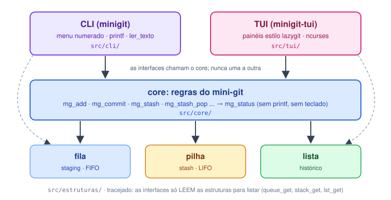

# Arquitetura do Mini-Git

Este documento explica como o código está dividido e como estender o projeto sem
misturar interface com funcionalidade. Para compilar e usar, veja o [README](../README.md).



## 1. A ideia: ortogonalidade

Dois eixos ortogonais são independentes: andar no X não muda o Y. No código, isso quer
dizer que **mudar uma coisa não obriga a mudar outra**:

| Se eu mudar... | ...só mexo em |
|---|---|
| a fila circular para uma fila encadeada | `src/estruturas/fila.c` |
| a regra do `stash pop` | `src/core/minigit.c` |
| o texto de um erro | `mg_mensagem` em `src/core/minigit.c` (vale para as duas interfaces) |
| a cor de um painel ou o layout da TUI | `src/tui/paineis.c` |
| a tecla de uma ação | uma linha de `TECLAS[]` em `src/tui/teclas.c` |
| a ordem das opções do menu | `OPCOES[]` em `src/cli/menu.c` |
| o tamanho máximo do staging | `MAX_STAGING` em `include/estruturas/tipos.h` |

Se uma mudança obriga a mexer em duas camadas ao mesmo tempo, é sinal de acoplamento.

## 2. As camadas

### `estruturas/`: fila, pilha, lista

- Não fazem I/O e não sabem o que é git. Só o `typedef` (`queue_info`, `stack_info`,
  `lst_info`) liga cada uma ao tipo guardado.
- Têm funções de leitura sem efeito colateral para as interfaces poderem listar:
  `queue_get`, `stack_get` (recebe `const pilha *`) e `lst_get`.

### `core/`: as regras

- `repositorio.h`: a struct `Repositorio` (staging + stash + histórico + contadores de id).
- `minigit.h`: toda operação que **altera** o repositório. Recebe os dados prontos e devolve
  um `mg_status`, sem imprimir nada e sem ler o teclado.
- `mg_pode_*` dizem se a operação faz sentido **antes** de a interface pedir dados.
- `mg_mensagem(status)` dá o texto do erro, o mesmo nas duas interfaces.

### `cli/`: menu numerado

- `entrada.c`: leitura segura de linha e de número.
- `comandos.c`: um `cli_*` por opção. O padrão é: `mg_pode_*`, ler dados, `mg_*`, imprimir.
- `menu.c`: a tabela `OPCOES[]` {seção, texto, função}.

### `tui/`: painéis estilo lazygit (ncurses)

| Arquivo | Responsabilidade | Altera o repositório? |
|---|---|---|
| `estado.c` | Estado da **tela**: painel ativo, cursor de cada painel, aviso | não |
| `paineis.c` | Desenha tudo a partir de `const Tui *` | não |
| `popup.c` | Caixa de texto e confirmação; não conhece o mini-git | não |
| `teclas.c` | Tabela `TECLAS[]` {painel, tecla, rótulo, descrição, na barra, ação} e despacho | não |
| `acoes.c` | Uma `acao_*` por tecla: popup, `mg_*`, aviso | **sim, só pelo core** |
| `tui.c` | Inicia o ncurses e roda o laço desenhar → ler tecla → despachar | não |

A barra de teclas e a janela de ajuda (`?`) são geradas da tabela `TECLAS[]`. Por isso
nunca ficam diferentes do que as teclas fazem.

O estado da tela (`Tui`) é separado do `Repositorio`. O cursor e o painel ativo são coisa
da interface, não do git, e a CLI nem precisa deles.

## 3. Quem garante as regras: o Makefile

```
estruturas  compila com  -Iinclude/estruturas
core        compila com  -Iinclude/estruturas -Iinclude/core
cli         compila com  ... -Iinclude/cli
tui         compila com  ... -Iinclude/tui  + ncurses
```

- Se o core fizer `#include "paineis.h"`, aparece o erro `paineis.h: arquivo inexistente`.
- Se o core chamar `initscr()`, aparece o erro `undefined reference to 'initscr'` no link
  do `minigit`, porque só a TUI liga com `-lncursesw`.

## 4. Receita: criar um comando novo

Exemplo: um comando "limpar staging" (esvaziar a fila sem commit).

1. **Core**: em `minigit.h`/`minigit.c`, criar `mg_status mg_limpar_staging(Repositorio *r, int *removidos);`
   usando só `dequeue`.
2. **CLI**: em `comandos.c`, criar `cli_limpar_staging`, que chama o core e imprime o
   resultado. Depois, uma linha em `OPCOES[]`.
3. **TUI**: em `acoes.c`, criar `acao_limpar_staging`, com confirmação, chamada ao core e
   `estado_avisar`. Depois, uma linha em `TECLAS[]`, por exemplo
   `{ P_STAGING, 'x', "x", "limpar staging", true, acao_limpar_staging }`.

Nenhum outro arquivo muda: os painéis, a barra e a ajuda se atualizam sozinhos.

## 5. Receita: uma terceira interface

Uma GUI gráfica (GTK, raylib) ou uma versão web entra como uma nova pasta
`src/<nome>/` com o seu `main.c`. Ela só usa `minigit.h` e as funções de leitura das
estruturas. No `Makefile` entram um padrão `build/<nome>/%.o` com
`$(INC_CORE) -Iinclude/<nome>` e um executável. As camadas `estruturas`, `core`, `cli` e
`tui` não mudam.

## 6. Decisões e por quê

| Decisão | Por quê |
|---|---|
| ncurses (e não GTK/raylib) | O lazygit é uma TUI. O ncurses é o padrão em C, já vem no Linux e tem a mesma API do PDCurses no Windows |
| `mg_status` em vez de `bool` | A interface precisa saber **qual** erro aconteceu para mostrar a mensagem certa |
| `mg_pode_*` separados | Evita pedir dados que serão recusados, sem duplicar a regra na interface |
| `stash_pop` usa `top` antes de `pop` | Se não couber no staging, o stash não pode ter saído da pilha |
| Commits do mais novo para o mais antigo na TUI | Igual ao `git log` e ao lazygit. A lista guarda do mais antigo ao mais novo; só a exibição inverte |
| Tabelas (`OPCOES[]`, `TECLAS[]`) com ponteiro para função | Comando novo é uma linha; a barra e o menu são gerados, não escritos à mão |
| Popups só aceitam ASCII | Os campos têm tamanho fixo em bytes; um acento em UTF-8 ocupa 2 bytes e quebraria o corte |
